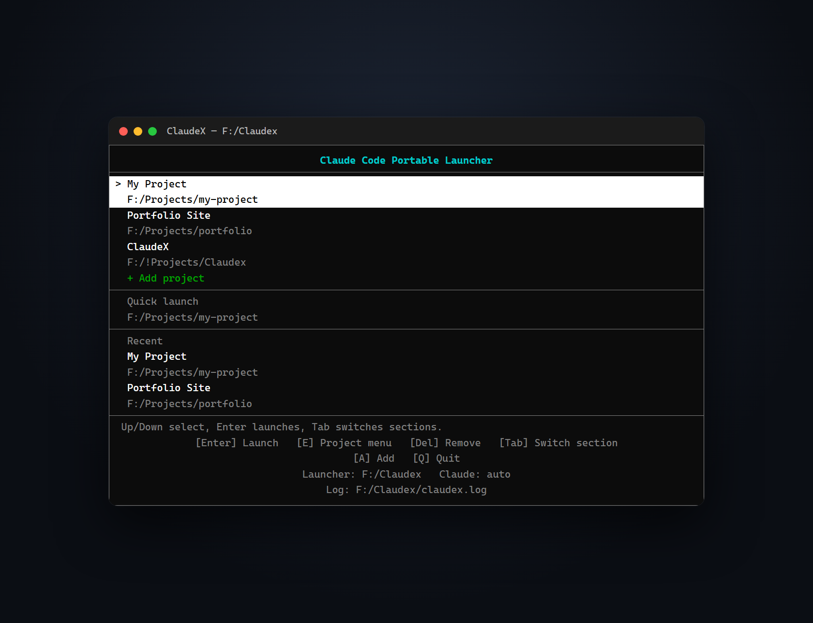

<p align="center">
  
</p>

<h1 align="center">ClaudeX</h1>

<p align="center">
  English | <a href="README.zh-CN.md">简体中文</a>
</p>

<p align="center">
  <strong>Portable</strong> and deeply customizable, keyboard-first launcher
  for Claude Code — one self-contained folder with an isolated
  <code>CLAUDE_CONFIG_DIR</code>.
</p>

<p align="center">
  
  <a href="LICENSE"></a>
  
  
</p>

> **Unofficial project.** ClaudeX is an independent, community-made launcher.
> It is not affiliated with, endorsed by, or supported by Anthropic. “Claude”
> and “Claude Code” are trademarks of Anthropic. ClaudeX does not bundle Claude
> Code; you need your own installation and account to use it.



The launcher itself is a single FTXUI executable. It works on Windows, macOS,
and Linux. The source chooses the right executable name and layout for the host
platform automatically.

## Highlights

- **Truly portable Claude Code**: one self-contained folder with an isolated
  `CLAUDE_CONFIG_DIR`, temporary folder, and config. Move or copy the whole
  folder to a USB drive or another machine and keep your setup intact.
- **Deeply customizable**: almost the entire UI comes from JSON themes. Page
  layouts are built from blocks (`hbox`/`vbox`/`box`), and inline or whole-row
  markup controls colors; custom project actions, key bindings, status
  messages, borders, and separators are all theme fields. You can even rebuild
  the main screen as a Claude Code-style welcome page.

## Main menu

```text
Claude Code Portable Launcher
────────────────────────────────────────
> F:/Projects/my-project
  ../another-project
  + Add project
────────────────────────────────────────
Quick launch
 F:/Projects/my-project
────────────────────────────────────────
Recent
  F:/Projects/previous-project
────────────────────────────────────────
 Up/Down select, Enter launches, Tab switches sections.
 [Enter] Launch   [E] Project menu   [Del] Remove   [Tab] Switch section
 [A] Add   [Q] Quit
 Launcher: F:/Claudex   Claude: auto
 Log: F:/Claudex/claudex.log
```

- `Enter` launches Claude in the highlighted project. Only the focused section
  shows the `>` cursor and the inverse highlight; the other sections keep their
  selection but draw it with the inactive prefix.
- `+ Add project` is always the last row and can be reached with the arrow keys.
- The add/edit screen has two fields: the optional project name and the folder
  path. Arrow keys move to the input the theme actually draws in that
  direction; `Up`/`Down` first walk the wrapped lines of a multi-line value.
  `Tab`/`Shift+Tab` cycle through the inputs in layout order. Enter saves and
  Esc cancels. `Shift+Enter` inserts a line break in any input field without
  submitting. The name is markup, so a project can carry its own color.
  `E` → `Edit project` opens both fields; the old separate `Rename` action was
  removed because it edited the same screen.
- The input placeholders come from the theme's `pathPlaceholder` (default
  `{drive}/Projects/my-project`, so it follows the launcher's drive) and
  `projectNamePlaceholder`.
- The `Recent` section lists the most recently launched projects, newest first.
  Its size and position come from the theme; see
  [`recentList`](#custom-screens-full-layout-control).
- `Quick launch` is its own section: a heading followed by the input row. It
  starts Claude in a typed folder once, without adding it to the project list.
  The folder still has to exist.

Other keys:

| Key | Action |
| --- | --- |
| `Shift+Enter` | Insert a line break in the focused input instead of submitting (`Alt+Enter` works where the terminal does not report Shift+Enter) |
| `Tab` / `Shift+Tab` | Cycle focus between sections in the order they appear in the layout |
| `Up` / `Down` | Move inside the focused section; at its first/last row, move to the adjacent section |
| `Left` / `Right` | Move within a grid row; on a single-column list they change sections. In the quick-launch and path-screen inputs they move the text cursor, and only at its edges do they move to the input/section drawn in that direction |
| `Enter` (quick launch) | Launch Claude once in the typed folder |
| `Esc` (quick launch) | Leave the input without quitting |
| `E` or `F2` | Open the selected project's action menu |
| `Delete` | Remove the selected project (asks first) |
| `A` | Open the add-project screen |
| `Esc` or `Q` | Quit |
| `Y` / `N` | Confirm/cancel a create or remove prompt |
| `Enter` (confirm dialogs) | Same as `Y`: create the folder or remove the project |

These are defaults; rebind them with [`keys`](#key-bindings) in the theme file.
`A` also opens the add-project screen, which is useful when the add row is
hidden.

Mouse (every screen):

| Input | Action |
| --- | --- |
| Hover a row or button | Apply the hover highlight |
| Hover a main-screen row | Move the focus and the active cursor to that row |
| Left click a row | Activate the row, like `Enter` |
| Left click a button | Run that button's action (`Continue`, `Cancel`, `Create`, `Back`, `Remove`) |
| Right click a project row | Open that project's action menu |
| Wheel | Focus the section under the pointer and move its selection |

The path screen shows clickable `Continue` / `Cancel` buttons, the create and
remove dialogs show clickable `Create` / `Back` and `Remove` / `Cancel`
buttons, and the project action menu (`E`) supports hover and click. The
keyboard shortcuts (`Enter`, `Esc`, `Y`, `N`) keep working everywhere.

Sections are traversed top to bottom in the order their blocks appear in
`screens.main.blocks`, so moving the `projectList`, `quickInput`, and
`recentList` blocks also changes the Up/Down and Tab order. Set
`tabOnlySectionSwitch` to `true` in the config to stop Up/Down from leaving a
list at its first/last row; `Tab` and `Shift+Tab` still switch sections. With
the default `false`, `Up`/`Down` in the single-line quick-launch field switch
sections directly, and at the edges of the project or recent list they move to
the adjacent section.

The project action menu defaults to `Launch Claude`, `Edit path`, `Move up`,
`Move down`, `Move to top`, `Move to bottom`, `Remove from list`, and `Back`;
replace or extend it with
[`projectMenu.actions`](#custom-project-actions). The move actions reorder the
selected project in the list; they have no dedicated shortcuts and are chosen
from this menu. The saved list order is the order shown on the main screen and
written to the config file.

The launcher clears the terminal when it starts, immediately before launching
Claude, after Claude exits, and when the launcher exits. This uses the Windows
console API on Windows and ANSI clear sequences on Linux/macOS, so Claude and
Claudex do not share half of the screen.

The vendored FTXUI copy has its DECRQSS cursor-shape query disabled because
unsupported terminals print the query payload (`$q q`) onto the screen. It
also forwards Windows Shift+Enter as a CSI-u sequence (`\x1b[13;2u`), which
FTXUI has no built-in event for; the launcher uses it to insert a line break.

## Quick start

Download the archive for your platform from the
[latest release](https://github.com/JPTV-21/Claudex/releases/latest):

| Platform | Asset |
| --- | --- |
| Windows x64 | `ClaudeX-windows-x64.zip` |
| Windows arm64 | `ClaudeX-windows-arm64.zip` |
| macOS x64 | `ClaudeX-macos-x64.tar.gz` |
| macOS arm64 | `ClaudeX-macos-arm64.tar.gz` |
| Linux x64 | `ClaudeX-linux-x64.tar.gz` |
| Linux arm64 | `ClaudeX-linux-arm64.tar.gz` |

Extract the archive and run `ClaudeX.exe` (`ClaudeX` on macOS/Linux). The
executable is self-contained; no installer is required. The Windows build links
the C/C++ runtime statically, so it does not need the Visual C++
Redistributable.

### One-step portable setup

The setup scripts live in a separate repository:
**[JPTV-21/claude-code-portable](https://github.com/JPTV-21/claude-code-portable)**.

They download the matching ClaudeX release, fetch the Claude Code binary, and
write a portable `claudex-config.json`. Windows can use `setup-portable.ps1`
(no Git required) or `setup-portable.bat`; Linux and macOS use
`setup-portable.sh`. See that repository's README for the interactive prompts
(platform, architecture, install directory), the `all` layout, and unattended
options.

## Portable configuration

The launcher config defaults to `./claudex-config.json` and the theme to
`./claudex-theme.json`, both next to the executable. Portable Claude data
defaults to `./data/`:

```text
ClaudeX.exe                 (or ClaudeX on macOS/Linux)
claudex-config.json         launcher settings, theme path, and project list
claudex-theme.json          menu text, layout, actions, keys, and messages
claudex.log                 launcher diagnostics log
data/                       portable CLAUDE_CONFIG_DIR (created on launch)
  tmp/                      portable temporary folder (created on launch)
bin/
  x86_64/claude.exe         optional portable Claude binary; set claudePath
  arm64/claude.exe          to "bin/{arch}/claude*" to use this layout
```

The theme file is created automatically from the embedded default theme when
it is missing. Its location comes from the config's `theme` field; relative
theme paths start at the launcher folder. The `theme` field, and every other
path field in the config, supports placeholders, environment variables, `~`,
and `*`/`?` wildcards (see
[Path templates and variables](#path-templates-and-variables)). By default the
launcher looks for `claude*` in its own folder and then on `PATH`; the `bin/`
layout is opt-in through `claudePath`.

Relative project paths stay relative and are resolved from the launcher
folder; they are not converted to absolute paths just because they point
outside the launcher folder. Relative paths that resolve inside the launcher
folder are shortened to a clean relative form (no `..`). Absolute paths inside
the launcher folder are also stored relative so the folder stays movable;
other absolute paths stay absolute. The path is only resolved to decide
whether to ask about creating a missing folder.

A project path entered with a path template (`{root}`, `{drive}`, `{home}`,
environment variables, or a leading `~`) is stored in its template form
(Windows backslashes become forward slashes), because the template is expanded
again every time the project is resolved. This keeps one config usable across
drives or machines: for example, adding `{drive}/Projects/my-project` stores
that template, and the launcher resolves it to whichever drive it runs from.
Input containing `*` or `?` wildcards is still resolved to the single matching
folder when the project is added, so the stored path is concrete.

The launcher writes `claudex-config.json` and `claudex-theme.json` on first
run. They can be edited by hand while the launcher is closed. A corrupt config
is backed up to `claudex-config.json.invalid`; a corrupt theme is backed up to
`claudex-theme.json.invalid` and replaced with the default theme. Configs from
older versions that still contain an inline `menu` object are migrated
automatically: the menu is merged into the theme file, then removed from the
config.

The config file location can be changed with `--config PATH` or
`CLAUDEX_CONFIG`; both also accept placeholders and environment variables. All
launcher settings, including the data locations (`claudeConfigDir` and
`tempDir`), are normal config fields.

The config file can also be selected from the config itself, the same way
`theme` selects the theme file: copy `claudex-config.json` to the new location
yourself, then set `configFile` in the config you launch to that path. The
launcher only follows the path; nothing is copied, moved, or deleted
automatically, and the original file is left as it is (it can keep serving as
the small bootstrap that points at the new file). Placeholders and environment
variables are expanded, and a relative `configFile` starts at the launcher
folder. If the target does not exist, the launcher creates a new default
config there. Only the bootstrap's `configFile` field is read; its other
fields are ignored. `configFile` switches only the config file: the theme,
`data/`, `tmp/`, and the log still resolve from the launcher folder.

Existing `data/launcher.json` files and the old project-array format are not
read or migrated automatically. Set the config path explicitly if you want to
keep an existing file at another location.

### Defaults and startup repair

Default values are not hardcoded in C++. They live in
`resources/default-config.json` and `resources/default-theme.json`, which CMake
embeds into the executable at configure time. The launcher trusts these
resources to be valid; there is no second set of fallback defaults.

On every startup, before drawing the menu, the launcher:

- creates `claudex-theme.json` if the resolved theme file is missing;
- merges missing theme keys and wrong JSON types from the default theme, and
  writes a `.before-fix` backup of the previous theme;
- backs up unparseable theme JSON to `.invalid` and replaces it with the
  merged/default theme (or leaves it untouched if the backup fails);
- adds missing config keys using the default values, including a missing
  `claudeExclude`;
- accepts a string `launchCommand` as shorthand for both platforms, and fills
  missing or blank `windows`/`posix` entries from the default object;
- replaces empty `theme`, `claudePath`, `launchCommand`, `claudeConfigDir`, and
  `tempDir` values with the default values, so the saved config is explicit;
  an empty `configFile` is kept because it means "keep the current file";
  an empty `logFile` is kept because it disables logging, and an empty
  `claudeExclude: []` is kept because it means "exclude nothing";
- replaces config keys whose JSON type is wrong with the default value;
- keeps every valid user value and other extra user key;
- writes a backup to `claudex-config.json.before-fix` before repairing the
  config.

Configs from an incompatible layout are not converted. Unparseable config or
theme JSON, and the project-array config format, cannot be compared key-by-key,
so they are reported and left untouched; replace them with a current config.

### Logging

The launcher writes `claudex.log` beside the executable by default. The log
records startup, the resolved config/theme paths, config saves and repairs,
theme creation and repairs, the resolved Claude executable, arguments, working
directory, portable config/temp folders, launch failures, and Claude's exit
code. Claude's interactive terminal output is not redirected,
because that would break the CLI UI.

Set `logFile` in the config to relocate the log, or set it to an empty string to
disable logging.

### Config fields

```json
{
  "version": 1,
  "theme": "claudex-theme.json",
  "configFile": "",
  "claudePath": ["claude*"],
  "claudeExclude": ["ClaudeX*"],
  "launchCommand": {
    "windows": "set \"CLAUDE_CONFIG_DIR={claudeConfigDir}\" && set \"TEMP={tempDir}\" && set \"TMP={tempDir}\" && set \"TMPDIR={tempDir}\" && {claude}",
    "posix": "CLAUDE_CONFIG_DIR='{claudeConfigDir}' TEMP='{tempDir}' TMP='{tempDir}' TMPDIR='{tempDir}' {claude}"
  },
  "claudeConfigDir": "data",
  "tempDir": "data/tmp",
  "logFile": "claudex.log",
  "tabOnlySectionSwitch": false,
  "defaultProjectName": "",
  "projects": [
    {
      "path": "../my-project",
      "lastUsed": "2026-10-26T12:00:00",
      "name": "<accent>My project</accent>"
    }
  ]
}
```

`name` is optional. It is markup, resolved like every other theme string, so a
project can carry its own color from the theme's variables. The same path may
be listed more than once.

| Field | Meaning |
| --- | --- |
| `theme` | Theme JSON path. Missing or empty means `claudex-theme.json`. Supports placeholders and wildcards. |
| `configFile` | Optional path of the config file to load instead of this one. Copy the file there yourself; the launcher only follows the path, like `theme`. Missing or empty keeps the current file. Relative paths start at the launcher folder. |
| `claudePath` | Where to find Claude. A string or an array of strings. Each entry may be a file, a directory, a wildcard path, or a bare name/pattern such as `claude*`. A directory entry means `<directory>/claude*`. Empty or missing uses the default `["claude*"]`: the launcher folder, then `PATH`. See [Claude executable detection](#claude-executable-detection). |
| `claudeExclude` | User-written exclusions for Claude executable detection. A string or an array of strings. A pattern without a path separator (`/`, or `\` on Windows) that does not expand to an absolute path matches the candidate file name (or stem); otherwise it matches the expanded full path. Supports `*` and `?`; Windows is case-insensitive. Defaults to `["ClaudeX*"]`; an empty array excludes nothing. |
| `launchCommand` | Shell command used to start Claude. A string applies to every platform; an object may provide `windows` and `posix` variants. Defaults to an object that sets `CLAUDE_CONFIG_DIR`, `TEMP`, `TMP`, and `TMPDIR` from the placeholders and runs `{claude}`. Placeholders: `{claude}`, `{claudeConfigDir}`, `{tempDir}`, and the path tokens below. Commands without `{claude}` run as-is and skip detection. Extra arguments go directly in the command, for example `"{claude} --model sonnet"`. |
| `claudeConfigDir` | Portable Claude config/data folder. Defaults to `data`. Relative paths start at the launcher folder. |
| `tempDir` | Portable temporary folder used by the default `launchCommand` for `TEMP`, `TMP`, and `TMPDIR`. Defaults to `data/tmp`. |
| `logFile` | Launcher diagnostics log. Empty disables logging. |
| `tabOnlySectionSwitch` | When `false` (default), Up/Down also move between main-screen sections at a list's first/last row. When `true`, only Tab/Shift+Tab switch sections. The order follows the `screens.main.blocks` layout. |
| `defaultProjectName` | Prefilled into the optional project-name field when a project is added. Empty (the default) leaves the field blank. Only affects new projects, not edits; the value is trimmed like a typed name and may contain markup. |
| `projects[].path` | Folder to start Claude in. Relative paths start at the launcher folder and stay relative when saved. |
| `projects[].lastUsed` | Timestamp updated when a project is launched. Drives the recent list; a newly added project stays empty until it is launched. |

### Theme file and menu appearance

Menu text and layout live in `claudex-theme.json`, selected by the config's
`theme` field. The flat keys below fill in text and styling; `screens` controls
the page structure itself (see
[Custom screens](#custom-screens-full-layout-control)). Defaults live in
`resources/default-theme.json`; missing theme keys are repaired automatically
at startup. Theme changes are read at startup, so restart Claudex after editing
the theme.

There is one title only: `titleFormat`. Colors and bold are written inline
with tags instead of separate `titleColor`, `titleBold`, etc. keys:

```json
{
  "addProjectLabel": "<success>+ Add project</success>",
  "projectEntryFormat": "<path>",
  "projectNameDisplay": "both",
  "titleFormat": "<bold><orange>------ ClaudeX ------</orange></bold>",
  "titleAlign": "center",
  "borderStyle": "double",
  "borderCharacters": "",
  "separatorStyle": "light",
  "separatorCharacter": "-",
  "activePrefix": "> ",
  "inactivePrefix": "  ",
  "hintText": "<graydark>Up/Down select, Enter launches, Tab switches sections.</graydark>",
  "tinyHintEnabled": true,
  "tinyHintText": "PLEASE GIVE A BIGGER PLACE",
  "tinyHintMinWidth": 30,
  "tinyHintMinHeight": 6,
  "pathPlaceholder": "{drive}/Projects/my-project",
  "projectNamePlaceholder": "Optional display name, markup allowed",
  "recentTitleFormat": "<graydark>Recent</graydark>",
  "recentEntryFormat": "<path>",
  "recentEmptyText": "",
  "recentLimit": 5,
  "quickInputLabel": "<graydark>Quick launch:</graydark>",
  "quickInputPlaceholder": "{drive}/Projects/my-project",
  "pathContinueLabel": "<green>[Enter] Continue</green>",
  "pathCancelLabel": "<graydark>[Esc] Cancel</graydark>",
  "confirmCreateLabel": "<green>[Y] Create</green>",
  "confirmCreateBackLabel": "<graydark>[N] Back</graydark>",
  "confirmRemoveLabel": "<red>[Y] Remove</red>",
  "confirmRemoveBackLabel": "<graydark>[N] Cancel</graydark>",
  "footerAlign": "center",
  "footerLines": [
    "<graydark>[Enter] Launch   [E] Project menu   [Del] Remove</graydark>",
    "<graydark>[Q] Quit</graydark>",
    "<graydark>Launcher: <root>   Claude: <claude></graydark>",
    "<graydark>Log: <log></graydark>"
  ]
}
```

| Key | Meaning |
| --- | --- |
| `titleFormat` | Literal multi-line title. `\n` starts a new line. Empty hides the title. |
| `titleAlign` | Title alignment: `left`, `center`, or `right`. |
| `borderStyle` | `none`, `light`, `dashed`, `heavy`, `double`, `rounded`, or `empty`. |
| `borderCharacters` | Custom border glyphs; empty uses `borderStyle`. One character draws a solid border; six characters set top-left, top, top-right, side, bottom-left, bottom-right, for example `"╭─╮│╰╯"`. Spaces between the six glyphs are allowed. |
| `separatorStyle` | Style of the lines around the project list. |
| `separatorCharacter` | Overrides the separator style with a repeated character, for example `-`. |
| `activePrefix` / `inactivePrefix` | Prefixes for the active row and normal rows; markup is allowed. Only the focused section uses `activePrefix`, so exactly one row looks active across the whole screen. |
| `projectEntryFormat` | Project row template for single-line rows. Use `<path>`/`{path}` and `<name>`/`{name}`; markup is allowed. `projectList.entryLines` (see below) builds multi-line rows and takes priority. |
| `projectNameDisplay` | Where the optional project name is drawn: `both` (default; pinned and recent lists), `pinned` (project list only), `recent` (recent list only), or `none`. When a list does not show names, `{name}`/`<name>` expands to nothing and a line made only of it is dropped. |
| `addProjectLabel` | Label for the final add-project row; markup is allowed. |
| `hintText` | Hint line shown when there is no status. |
| `tinyHintEnabled` | Draw `tinyHintText` instead of the pages while the terminal is smaller than `tinyHintMinWidth` × `tinyHintMinHeight`. Set to `false` to always draw the normal UI, however small the terminal is. |
| `tinyHintText` | Fallback message, markup is allowed. When it is wider than the terminal it scrolls a column at a time so every character can still be read. |
| `tinyHintMinWidth` / `tinyHintMinHeight` | Terminal size below which the fallback takes over; `0` disables that dimension. Defaults are `30` and `6`. |
| `projectNamePlaceholder` | Hint shown in the project-name field on the add/edit screen. Path templates are expanded; markup is allowed. |
| `pathPlaceholder` | Hint shown in the add-project path field. Supports path templates such as `{drive}`, `{home}`, and `{root}`; markup is allowed; empty hides it. |
| `footerAlign` / `footerLines` | Footer alignment and complete footer line list. |
| `recentTitleFormat` | Heading shown by a `recentList` block. Empty hides the heading. |
| `recentEntryFormat` | Recent row template. Supports `<path>`/`{path}`, `<name>`/`{name}` and `<lastUsed>`/`{lastUsed}`; markup is allowed. |
| `recentEmptyText` | Text shown when a `recentList` block has no entries. Empty hides the block. |
| `recentLimit` | Default maximum number of recent rows; `0` disables the list. A block's `limit` overrides it. |
| `quickInputLabel` | Label in front of the main-screen quick-launch input. Markup is allowed; empty hides it. |
| `quickInputPlaceholder` | Placeholder in the quick-launch input. Path templates are expanded; markup is allowed. Typed paths stay literal. |
| `pathContinueLabel` / `pathCancelLabel` | Clickable buttons on the add/edit path screen. Markup is allowed. |
| `confirmCreateLabel` / `confirmCreateBackLabel` | Clickable buttons on the "create this folder?" dialog. Markup is allowed. |
| `confirmRemoveLabel` / `confirmRemoveBackLabel` | Clickable buttons on the "remove project?" dialog. Markup is allowed. |
| `variables` | Named colors and sizes (CSS-style variables) usable in markup, block colors, and width/height keys; see [Theme variables](#theme-variables). |
| `colors` | Older name for the same table; `variables` wins when both define a name. |
| `screens` | Full page structure; see [Custom screens](#custom-screens-full-layout-control). |
| `keys` | Key bindings; see [Key bindings](#key-bindings). |

### Theme variables

`variables` is one table of named values used by both colors and sizes. String
values are colors; integer values are sizes. Definitions may point at built-in
colors, hex values, palette indexes, other names, or (for sizes) other numeric
variables:

```json
"variables": {
  "success": "green",
  "error": "red",
  "warning": "yellow",
  "accent": "#22aaff",
  "listHeight": 10,
  "sideWidth": "listHeight"
}
```

Use a color as a tag (`<success>Project added.</success>`) or as a block color
(`"color": "error"`); use a size anywhere a width or height is accepted
(`"width": "sideWidth"`). Names are case-insensitive and ignore `-`, `_`, and
spaces, so `--success` and `success` are the same name.

The theme is the only source of color names: the code has no built-in list.
The shipped default theme defines the common names (`black`, `red`, `green`,
`yellow`, `blue`, `magenta`, `cyan`, `white`, `graylight`/`gray`/`grey`,
`graydark`/`greydark`, and the six `*light` names) and then the semantic ones
(`success`, `error`, `warning`, `accent`, `muted`) on top of them.

Definitions are yours alone: startup repair fills in missing theme keys but
never adds or rewrites entries inside `variables`/`colors`. Names the active
theme does not define stay literal text (or fall back to the key's default for
sizes). `colors` still works as the older name for the same table; when both
define a name, `variables` wins. Reference cycles stop at the lookup depth and
are written to `claudex.log` as a `variable cycle` warning.
The code never assigns a color to a status line itself: the message text
carries its own markup, and the default theme wraps messages in `<success>`,
`<error>`, and `<warning>`.

### Inline menu markup

Any configurable menu text supports nested inline tags:

```text
<accent>accent text</accent> <white>111<bold>222</bold>111</white>
```

Supported tags:

- Names defined by the theme's `variables`, for example `<success>`, `<error>`,
  `<muted>`, `<red>`, or any name you add. The default theme ships the common
  color names listed under [Theme variables](#theme-variables); anything else
  (for example `orange`) must be defined in `variables` first. Names are
  matched case- and separator-insensitively.
- Hex colors: `<#ff8800>text</#ff8800>` (or `#RGB`)
- Palette colors: `<196>text</196>`
- Background colors: `<on-red>text</on-red>`, `<bg-#ff8800>text</bg-#ff8800>`,
  `<on196>text</on196>`. The `on`/`bg` prefix accepts the same names, hex
  values, and palette indexes as foreground tags.
- Styles: `<bold>`/`<b>`, `<dim>`, `<italic>`/`<i>`,
  `<underline>`/`<underlined>`/`<u>`, `<inverted>`/`<inverse>`
- Line directives: `<line ...>` styles a whole menu row instead of only the
  tagged text. `bg=` (also `background=` or `on=`) paints the background
  across the row width, including the prefix and the padding after the text;
  `fg=` (also `foreground=` or `color=`) sets the default text color; the
  style names above can be combined as bare words. For example
  `<line bg=#102030 fg=white bold>` gives a row a colored band. The directive
  applies to the entire line, `</line>` is optional, and inline tags still win
  on the text they cover. In a plain text block (title, footer, status) the
  color covers the text itself; menu rows and grid cells are filled to their
  full width. An invalid attribute or unknown color leaves the directive as
  literal text; a bare `<line>` is still an ordinary color tag for a theme
  variable named `line`.

Tags can be nested and must be closed on the same line. Unknown tags remain
literal text, so ordinary project paths containing `<` or `>` are not harmed.
Markup is parsed after placeholders such as `<root>` and `<project>` are
expanded.

Markup applies to `titleFormat`, `hintText`, `footerLines`, `addProjectLabel`,
`projectEntryFormat`, `activePrefix`/`inactivePrefix`, `pathPlaceholder`,
`projectNamePlaceholder`, `quickInputPlaceholder`, `tinyHintText`, all
`projectMenu` text fields and action labels, theme `messages`, and every screen
block that renders text (including `status`, `statusOrHint`, and `error`). Text
typed into an input is always literal, so a path can contain `<` and `>`. The
highlighted project row still uses inverse video.

### Custom screens (full layout control)

Every page is now an authored list of blocks under `screens` in
`claudex-theme.json`. The default theme in `resources/default-theme.json`
reproduces the built-in layout, so this is the complete page structure rather
than a small theme override.

```json
"screens": {
  "main": {
    "width": 100,
    "align": "center",
    "border": "theme",
    "blocks": [
      { "type": "title" },
      { "type": "separator" },
      { "type": "projectList", "height": 10 },
      {
        "type": "quickInput",
        "title": "<graydark>Quick launch</graydark>",
        "label": "",
        "separatorBefore": true
      },
      { "type": "recentList", "separatorBefore": true },
      { "type": "separator" },
      { "type": "statusOrHint" },
      { "type": "footer" }
    ]
  }
}
```

Screen names: `main`, `path`, `confirmCreate`, `projectActions`,
`confirmRemove`. Screen fields:

| Key | Meaning |
| --- | --- |
| `blocks` | Ordered (and nestable) block list. |
| `border` | `none`, `theme` (use `borderStyle`/`borderCharacters`), a named style (`light`, `dashed`, `heavy`, `double`, `rounded`, `empty`), or custom glyphs. |
| `width` | Maximum page width; `0` means unlimited. |
| `align` | `left`, `center`, or `right`. |
| `addTitle` / `editTitle` | Text for `{mode}` on the path screen. |

Blocks:

| Type | Purpose / keys |
| --- | --- |
| `title` | Theme title. `scope`: `main` or `project`; optional `text` override. |
| `projectFormat` | `projectMenu.projectFormat` line. |
| `text` | Literal or template text. `align`, `if`, `unless`. |
| `separator` | Separator line. `style`, `character` overrides. `vertical: true` (or `orientation: "vertical"`) draws a one-column line that fills the height of its row, so it works as a divider between `hbox` columns. |
| `blank` | One empty row. |
| `projectList` | Project list. `entryLines` (array of line templates, see below), `focusedEntryLines` (templates for the focused row), `entryFormat`, `activePrefix`, `inactivePrefix`, `addProject` (default `true`), `inverseHighlight` (default `true`), `maxHeight` (default `10`), `scroll`, `scrollbar`, `frame`, plus the grid keys below. |
| `recentList` | Recently launched projects, newest first. `entryLines`, `focusedEntryLines`, `limit` (default `recentLimit`), `title` (default `recentTitleFormat`), `titleAlign` (default `left`), `entryFormat` (default `recentEntryFormat`), `activePrefix`, `inactivePrefix`, `inverseHighlight`, `maxHeight`, `scroll`, `scrollbar`, `frame`, `emptyText` (default `recentEmptyText`), plus the grid keys below. Hidden while there are no entries unless `emptyText` is set. |
| `quickInput` | Input row for a one-time launch. `title` (heading drawn above the input, which makes it a section like `recentList`), `titleAlign` (default the block `align`), `label` (default `quickInputLabel`; set to `""` when the title already names the field). The typed folder is not added to the config. When the page is too short to show both, the title collapses first so the input stays usable. |
| `actionList` | Project action list. `inverseHighlight` (default `true`), `maxHeight`, `scroll`, `scrollbar`, `frame`, plus the grid keys below. |
| `buttons` | Clickable Back/Confirm buttons for the current page (alias `dialogButtons`). The button labels come from the theme keys above. Themes without this block get the buttons appended at the end of the page. |
| `pathInput` | The path input row. |
| `status` / `hint` / `statusOrHint` | Status message, hint line, or either (the default). Text is rendered as markup. |
| `error` | Path error, or `fallback` text when there is no error. Text is rendered as markup. |
| `footer` | Footer lines. `lines` array, or `scope: "project"` for `projectMenu.footerLines`; `align`. |
| `box` | Border around `children`. `border`, plus common layout keys. |
| `hbox` | Horizontal children. Each child may set `"flex": true`. |
| `vbox` | Vertical children. |
| `spacer` | Flexible empty space (`filler`). |

`projectList` and `recentList` each remember a selection, but only the section
that currently has keyboard focus draws its cursor (`activePrefix` plus the
inverse highlight). Hovering a row or a section with the mouse moves that focus.

Lists can render multi-line entries with `entryLines`, an array of line
templates. `focusedEntryLines` is an optional second array used only for the
row that has keyboard focus:

```json
{ "type": "projectList",
  "entryLines": ["{nameOrPath}"],
  "focusedEntryLines": ["{name}", "<muted>{path}</muted>"] }
```

Each line supports these placeholders, with either `{...}` or `<...>`
spelling:

| Placeholder | Expands to |
| --- | --- |
| `{name}` | The project's display name (may be empty). |
| `{path}` | The stored project path. |
| `{lastUsed}` | The recent-list timestamp (recent list only). |
| `{nameOrPath}` | The name when it has visible text; otherwise the path. |
| `{pathIfNamed}` | The path only when a visible name exists; otherwise empty. |
| `{pathIfUnnamed}` | The path only when no visible name exists; otherwise empty. |

A name counts as present only when its markup renders to visible text, so a
name such as `<red></red>` behaves like no name. Substitution is a single
pass: markup, placeholders, or token-looking text inside a name or path are
inserted literally and never expanded again. A line that expands to nothing is
dropped; an entry with no lines left falls back to its bare path. The cursor
prefix goes on the first line and continuation lines are indented to match.

Template priority for each row:

1. If the row is focused (its list has keyboard focus and the row is selected)
   and `focusedEntryLines` is non-empty, its lines are tried first.
2. If that produces no visible line, the base template is used instead.
3. The base template is `entryLines` when non-empty; otherwise one line from
   `entryFormat`.
4. Only when that is empty too does the row fall back to the bare path.

`entryLines` still takes priority over `entryFormat`. The `+ Add project` row
never uses either template. `projectNameDisplay` can suppress the name in
either list; a suppressed name expands as if the project had no name, so
`{nameOrPath}` becomes the path and `{pathIfNamed}` becomes empty.

Common display rules, for either list block:

```json
// Name when present, path when not.
"entryLines": ["{nameOrPath}"]

// Always show the path (the name line disappears for unnamed projects).
"entryLines": ["{name}", "<muted>{path}</muted>"]

// Focused row: name and path. Other rows: name only (path when unnamed).
"entryLines": ["{nameOrPath}"],
"focusedEntryLines": ["{name}", "<muted>{path}</muted>"]

// Focused row: name only (path when unnamed). Other rows: name and path.
"entryLines": ["{name}", "<muted>{path}</muted>"],
"focusedEntryLines": ["{nameOrPath}"]
```

To make a path-only project use the same emphasis as a named one while still
showing the muted path for named projects:

```json
"entryLines": [
  "<bold>{nameOrPath}</bold>",
  "<muted>{pathIfNamed}</muted>"
]
```

A named project renders a bold name plus a muted path. An unnamed project
renders a bold path and no second line. This is the shipped default theme; use
`<bold><white>` instead of `<bold>` if you also want to force a white
foreground. To keep path-only rows muted, simply keep the earlier
`["{name}", "<muted>{path}</muted>"]` form.

Lists accept grid keys:

| Key | Meaning |
| --- | --- |
| `columns` | `1` (default, a plain list), a number of columns, or `"auto"` to fill the available width with as many cells as fit. |
| `cellWidth` | Fixed cell width; `0` (default) widens every cell to the widest entry. |
| `columnGap` | Spaces between cells; default `2`. |
| `pageRows` | Rows moved by PageUp/PageDown; default `5`. |

When `focusedEntryLines` is used in a grid, both the focused and unfocused
variants are measured for the column width, so moving the cursor never reflows
the grid. A wider focused template can therefore make `columns: "auto"` choose
fewer columns; set a fixed `cellWidth` to avoid that.

In a grid, Up/Down move by a row and Left/Right move within a row. A list only
hands an arrow key back to the section switcher at its first and last entry, so
it keeps scrolling until it really ends. Left/Right do nothing on a
single-column list, which leaves them free for the text field.

`scroll` and `frame` are per-block keys; the shipped default theme enables them
on all three list blocks, so a list that no longer fits in the page scrolls
instead of being clipped. When enabled, height limits and the scrollbar count
rendered lines, not entries: a two-line entry occupies two rows. An optional
`scrollbar` object styles the bar:

| Key | Meaning |
| --- | --- |
| `position` | `right` (default) or `left`. |
| `width` | Thickness in columns; default `1`. |
| `maxWidth` | Upper bound for `width`; `0` (default) leaves it uncapped. |
| `color` | Foreground color, as a theme variable or literal. Unset inherits the list block's `color`. |
| `backgroundColor` (alias `bgColor`) | Background color. Unset follows the list content. |
| `characters` | One-cell glyphs: `full` (both halves of a row), `top` and `bottom` (the half-covered rows at the thumb's ends), and `empty` (the track). Defaults are `"┃"`, `"╻"`, `"╹"`, and `" "`. |

```json
{ "type": "projectList",
  "scrollbar": {
    "position": "left",
    "width": 2,
    "color": "accent",
    "characters": { "full": "█", "top": "▄", "bottom": "▀", "empty": "░" }
  } }
```

`top` and `bottom` name the end of the thumb, so the default `top` glyph `"╻"`
fills the lower half of its cell. A bar always leaves at least one column for
the content; on a page narrower than `width`, it shrinks rather than covering
the list.

Common block keys: `width`, `height`, `maxWidth`, `maxHeight`, `minWidth`,
`minHeight`, `align`, `color`, `backgroundColor` (alias `bgColor`),
`separatorBefore`, `separatorAfter`, `if`, `unless`.

`width` and `height` are exact sizes: a smaller block is padded with blanks and
a larger one is cut with `...`. `maxWidth`/`maxHeight` are upper bounds, so the
block shrinks to its content and is only cut when it is too big.
`minWidth`/`minHeight` raise the lower bound. All four accept a variable name.
Sizes include the block's own border. Text that does not fit is truncated with
dots that never push past the limit; a text block whose height limit drops
lines marks the last visible line the same way, while lists scroll instead.

`color` and `backgroundColor` accept the same values as markup colors and
apply to the whole block, including a box border.
`separatorBefore`/`separatorAfter` only draw when the block itself produces
content, so header and footer separators disappear automatically when their
content is empty.

Conditions for `if` / `unless`: `projects`, `noProjects`, `selected`,
`noSelection`, `status`, `noStatus`, `error`, `noError`, `addProject`,
`noAddProject`, `recent`, `noRecent`, `quickInput`.

All screen text is expanded with the usual placeholders plus:

| Placeholder | Value |
| --- | --- |
| `{path}` | Current path field, pending folder, or target project, depending on the screen. |
| `{mode}` | `addTitle` or `editTitle` on the path screen. |
| `{error}` | Current path error, if any. |
| `{status}` | Current status message. |
| `{theme}` | Theme file path (`disabled` when empty). |

For example, a Claude Code style main screen with a welcome card and no
outer border:

```json
"screens": {
  "main": {
    "width": 100,
    "align": "left",
    "border": "none",
    "blocks": [
      {
        "type": "box",
        "border": "rounded",
        "width": 74,
        "children": [
          { "type": "text", "text": " <bold><cyan>✻ Welcome to ClaudeX!</cyan></bold>" },
          { "type": "blank" },
          { "type": "text", "text": " <dim>Select a project below, or press A to add one.</dim>" },
          { "type": "blank" },
          { "type": "text", "text": " <dim>cwd:</dim> {path}" }
        ]
      },
      { "type": "blank" },
      { "type": "projectList", "height": 8, "activePrefix": " > ", "inactivePrefix": "   " },
      {
        "type": "quickInput",
        "title": "<dim>Quick launch</dim>",
        "label": "",
        "separatorBefore": true
      },
      { "type": "recentList", "limit": 3, "title": "<dim>Recent</dim>", "separatorBefore": true },
      { "type": "statusOrHint" },
      { "type": "footer", "lines": ["<dim>? for shortcuts</dim>"], "align": "left" }
    ]
  }
}
```

A ready-to-copy version is in `resources/presets/claude-code.menu.json`. Copy
its `screens`, `hintText`, `footerAlign`, and `footerLines` keys into
`claudex-theme.json`, then restart Claudex. Missing keys are filled in by theme
repair, so it is safe to use the preset as a partial theme.

Columns are just nested containers. This main screen puts the project list on
the left, a vertical divider in the middle, and the recent list above the quick
launch on the right:

```json
"screens": {
  "main": {
    "width": 100,
    "blocks": [
      { "type": "title" },
      { "type": "separator" },
      {
        "type": "hbox",
        "children": [
          {
            "type": "box", "border": "theme", "minWidth": 32, "width": 32,
            "children": [ { "type": "projectList" } ]
          },
          { "type": "separator", "vertical": true },
          {
            "type": "vbox", "flex": true,
            "children": [
              { "type": "box", "border": "none",
                "children": [ { "type": "recentList" } ] },
              { "type": "separator" },
              { "type": "box", "border": "none",
                "children": [ { "type": "quickInput", "label": "" } ] }
            ]
          }
        ]
      },
      { "type": "separator" },
      { "type": "statusOrHint" },
      { "type": "footer" }
    ]
  }
}
```

A fixed column width is just `"width": 34`; give the growing side `flex` (or
give both sides `flex` for equal columns). Each interactive block
(`projectList`, `recentList`, `quickInput`, `actionList`, `pathInput`,
`buttons`) exists once per screen, and `Tab` still walks them in the order they
appear in the block tree.

The same layout is available ready-made as
`resources/presets/two-column.theme.json`. It is only a preset: the launcher
never loads it on its own. Use it by pointing the config's theme field at it
(`"theme": "presets/two-column.theme.json"`), or copy its keys into the
existing `claudex-theme.json`; repair fills in every key the preset omits.

### Project menu appearance

The `E` project action menu has its own text and labels under `projectMenu` in
the theme file. It reuses the main menu's border, separators, alignment,
prefixes, and inverse highlight:

```json
"projectMenu": {
  "titleFormat": "<bold><accent>What to do with this project?</accent></bold>",
  "projectFormat": "<muted><project></muted>",
  "launchLabel": "<success>Launch Claude</success>",
  "editLabel": "Edit project",
  "removeLabel": "Remove from list",
  "backLabel": "Back",
  "moveUpLabel": "Move up",
  "moveDownLabel": "Move down",
  "moveTopLabel": "Move to top",
  "moveBottomLabel": "Move to bottom",
  "footerLines": [
    "<muted>[Up/Down] Select   [Enter] Choose   [Esc] Back</muted>"
  ]
}
```

| Key | Meaning |
| --- | --- |
| `titleFormat` | Action menu title text. Empty hides it. |
| `projectFormat` | Project path line. Use `<project>` or `{project}`. Empty hides it. |
| `launchLabel` / `editLabel` / `removeLabel` / `backLabel` | Default action labels. `edit` opens both fields (name and path). Older themes that still list a `rename` action get it folded into `edit` (or converted to it when no `edit` action exists); `renameLabel` is then ignored. |
| `moveUpLabel` / `moveDownLabel` / `moveTopLabel` / `moveBottomLabel` | Default labels for the four move actions. |
| `actions` | Full action list, including custom shell commands; see [Custom project actions](#custom-project-actions). |
| `footerLines` | Action menu footer lines. Empty hides them. |

The four move actions change the selected project's position in the list and
save the new order immediately. `moveUp`/`moveDown` move it one row, while
`moveTop`/`moveBottom` move it to the first or last position.

#### Custom project actions

`projectMenu.actions` replaces the built-in action list. `id` selects built-in
behavior; a non-empty `command` runs a shell command in the project folder
instead:

```json
"actions": [
  { "id": "launch" },
  { "id": "edit", "label": "Change folder" },
  { "id": "moveUp" },
  { "id": "moveDown" },
  { "id": "shell", "label": "Open shell", "command": "pwsh" },
  { "id": "remove", "label": "<red>Remove</red>" },
  { "id": "back" }
]
```

| Field | Meaning |
| --- | --- |
| `id` | `launch`, `edit`, `moveUp`, `moveDown`, `moveTop`, `moveBottom`, `remove`, `back`, or any custom name. A legacy `rename` id is treated as `edit` and skipped when `edit` is already listed. |
| `label` | Row label; markup is allowed. Built-in ids fall back to `launchLabel`, `editLabel`, the matching move label, `removeLabel`, and `backLabel` when empty. |
| `command` | Shell command run in the project folder. Overrides `id`. |

Commands run through `cmd.exe /d /s /c` on Windows and `/bin/sh -c`
elsewhere, after the portable environment is set. Only brace placeholders are
expanded in commands: `{root}`, `{config}`, `{theme}`, `{log}`, `{claude}`,
`{project}`, `{path}`. Angle brackets are left alone so shell redirection
still works.

#### Key bindings

`keys` in the theme file maps actions to keys. Each value is a string or array
of strings:

```json
"keys": {
  "quit": ["q", "esc"],
  "projectMenu": ["e", "f2"],
  "remove": ["delete"],
  "add": ["a"],
  "quickInput": ["tab"],
  "confirm": ["y"],
  "cancel": ["n", "esc"],
  "back": ["esc"]
}
```

| Key | Where it applies |
| --- | --- |
| `quit` | Main menu. |
| `projectMenu` | Opens the selected project's action menu. |
| `remove` | Asks to remove the selected project. |
| `add` | Opens the add-project screen (works even when the add row is hidden). |
| `quickInput` | Jumps to the main-screen quick-launch input. `Tab`/`Shift+Tab` always cycle focus between the visible main-screen sections in layout order, even if this binding is removed. |
| `confirm` | Confirmation screens (`y` by default). |
| `cancel` | Confirmation screens. |
| `back` | Path and project action screens (`esc` by default). Keep this separate from `cancel`: letters there are typed into the path field. |

Arrow keys are not bindable actions. Inside a section they move its selection
(Down/Up, and Left/Right inside a grid row). At a section's edge the key moves
the focus to the section that actually lies in that direction: the target is
picked from the sections' last drawn positions, so Down stays in the column and
Right crosses to the next column. When nothing lies in that direction (a plain
stacked layout has nothing left or right) the authored block order is the
fallback. With `tabOnlySectionSwitch`, arrows stop at the edge instead. In the
quick-launch field Left/Right edit the text cursor until it reaches an end.

Supported key names: single characters, `esc`, `enter`, `tab`, `tabreverse`,
`space`, `backspace`, `delete`, `insert`, `home`, `end`, `pageup`,
`pagedown`, `up`, `down`, `left`, `right`, and `f1`–`f12`. Set an empty array
to disable a binding. Up/Down move the selection and Enter activates the
highlighted row unless you explicitly bind those keys to something else.

All theme text fields, including screen block text, support both brace and
angle placeholders:

```text
{root} / <root>         {config} / <config>
{theme} / <theme>       {log} / <log>
{claude} / <claude>     {project} / <project>
```

`{claude}` shows `auto` when `claudePath` was not configured. With an array it
is joined with `" ; "` in menu text; in shell commands it expands to the first
entry, so a command cannot contain an ambiguous list.

The top-level `title` config field and the `{title}` placeholder are gone; use
the theme's `titleFormat` and `pathPlaceholder` instead. An extra key left in an
old config is kept as-is and ignored.

`projectMenu.titleFormat`, `projectMenu.projectFormat`, and
`projectMenu.footerLines` support the same placeholders.

### Status messages

Status lines, path errors, config errors, theme errors, and Claude launch
errors are configurable under `messages` in the theme file. Defaults live in
`resources/default-theme.json`; missing keys are added during startup repair.
Messages are single-line text and support both `{name}` placeholders and
inline markup (color tags, `<bold>`, `<dim>`, and the named colors defined by
the theme variables).

```json
"messages": {
  "projectAdded": "<success>Project added.</success>",
  "claudeExitedWithCode": "<success>Claude exited with code {code}.</success>",
  "pathNotFolder": "<error>That path is not a folder: {path}</error>",
  "selectProjectFirst": "<warning>Select a project first.</warning>"
}
```

Color is part of the message itself, not hardcoded by the block that shows it,
so the same status line can use any color the theme defines.

Project list and path entry:

| Key | Placeholders | Shown when |
| --- | --- | --- |
| `selectProjectFirst` | — | An action needs a selected project. |
| `projectAdded` | — | A project was added and saved. |
| `projectPathUpdated` | — | A project path was edited and saved. |
| `projectRemoved` | — | A project was removed and the config was saved. |
| `projectAddedSaveFailed` | `{error}` | A project was added but the config could not be saved. |
| `projectUnavailable` | — | The project selected for launching disappeared. |
| `projectNoLongerListed` | — | The project being edited disappeared. |
| `enterFolderPath` | — | The path field was submitted empty. |
| `invalidFolderPath` | — | The entered path could not be parsed. |
| `pathNotFolder` | `{path}` | The entered path exists but is not a folder. |
| `pathInspectFailed` | `{path}` `{error}` | The path could not be inspected. |
| `pathCreateFailed` | `{path}` `{error}` | The missing folder could not be created. |

Config:

| Key | Placeholders | Shown when |
| --- | --- | --- |
| `configCreated` | `{config}` | A missing config was written on first run. |
| `configRepaired` | `{backup}` | The config was repaired automatically. |
| `configRepairFailed` | `{error}` | Automatic repair failed. |
| `configSaveBeforeLaunchFailed` | `{error}` | The config could not be saved before launching Claude. |
| `configInspectFailed` | `{path}` `{error}` | The config path could not be inspected. |
| `configOpenFailed` | `{path}` | The config file could not be opened. |
| `configOldArrayFormat` | — | The old project-array config format was found. |
| `configUnsupportedFormat` | — | The config is not a JSON object. |
| `configProjectsNotArray` | — | The config's `projects` field is not an array. |
| `configParseFailed` | `{path}` `{error}` | The config JSON could not be parsed. |
| `configCannotRepair` | `{warning}` | The config cannot be repaired automatically. |
| `configBackupFailed` | `{backup}` `{error}` | The pre-repair backup could not be written. |
| `configFolderCreateFailed` | `{path}` `{error}` | The config folder could not be created. |
| `configSerializeFailed` | `{error}` | The config JSON could not be serialized. |
| `configWriteFailed` | `{path}` | The temporary config file could not be written. |
| `configFinishWriteFailed` | `{path}` | Writing the temporary config file failed. |
| `configInvalidBackupFailed` | `{backup}` `{error}` | An invalid config could not be backed up, so it was not overwritten. |
| `configReplaceFailed` | `{path}` `{error}` | The temporary config could not replace the real one. |

Theme:

| Key | Placeholders | Shown when |
| --- | --- | --- |
| `themeCreated` | `{path}` | A missing theme file was created. |
| `themeRepaired` | `{backup}` | The theme was repaired automatically. |
| `themeInspectFailed` | `{path}` `{error}` | The theme path could not be inspected. |
| `themeOpenFailed` | `{path}` | The theme file could not be opened. |
| `themeParseFailed` | `{path}` `{error}` | The theme JSON could not be parsed. |
| `themeUnsupportedFormat` | — | The theme is not a JSON object. |
| `themePathEmpty` | — | The resolved theme path is empty. |
| `themeFolderCreateFailed` | `{path}` `{error}` | The theme folder could not be created. |
| `themeBackupFailed` | `{backup}` `{error}` | The pre-repair theme backup could not be written. |
| `themeInvalidBackupFailed` | `{backup}` `{error}` | An invalid theme could not be backed up, so it was not overwritten. |
| `themeSerializeFailed` | `{error}` | The theme JSON could not be serialized. |
| `themeWriteFailed` | `{path}` | The temporary theme file could not be written. |
| `themeFinishWriteFailed` | `{path}` | Writing the temporary theme file failed. |
| `themeReplaceFailed` | `{path}` `{error}` | The temporary theme could not replace the real one. |

Claude and launch:

| Key | Placeholders | Shown when |
| --- | --- | --- |
| `claudeExited` | — | Claude exited with code 0. |
| `claudeExitedWithCode` | `{code}` | Claude exited with a non-zero code. |
| `claudeCouldNotStart` | — | Launching failed without a specific error. |
| `claudeProjectMissing` | `{path}` | The project folder does not exist. |
| `claudeNotRunnable` | `{path}` | The configured `claudePath` is a file but not runnable. |
| `claudePathNotFound` | `{path}` | A single configured `claudePath` entry was not found or was excluded by `claudeExclude`. |
| `claudeNotFound` | — | None of the `claudePath` entries or `PATH` contained a non-excluded Claude. |
| `claudeAmbiguous` | `{path}` `{candidates}` | A configured directory has several executables and none matches `claude*`. |
| `pathPatternNoMatch` | `{value}` | A wildcard path matched nothing. |
| `pathPatternAmbiguous` | `{value}` `{candidates}` | A project path wildcard matched more than one folder. |
| `environmentVariableFailed` | `{name}` `{error}` | A portable environment variable for a custom project action could not be set. |
| `createFolderFailed` | `{path}` `{error}` | The config or temp folder could not be created. |
| `notAFolder` | `{path}` | A portable folder path is not a directory. |
| `claudeStartFailed` | `{error}` | The Claude process could not be started. |
| `claudeWaitFailed` | `{error}` | Waiting for Claude failed. |
| `claudeExitCodeUnreadable` | `{error}` | The Claude exit code could not be read. |

The status line still uses green for normal statuses and red for errors; the
message text itself is not colored.

### Path templates and variables

`theme`, `claudePath`, `claudeExclude` (path patterns), `claudeConfigDir`,
`tempDir`, `logFile`, the theme's `pathPlaceholder`, project paths, and the
`--config` / `CLAUDEX_CONFIG` paths support:

| Token | Value |
| --- | --- |
| `{root}` | Launcher folder |
| `{platform}` | `windows`, `macos`, or `linux` |
| `{arch}` | `x86_64`, `arm64`, or `x86` |
| `{home}` | Current user home folder |
| `{drive}` | Windows: launcher drive (`F:`). macOS/Linux: the mount point of the filesystem containing the launcher, for example `/Volumes/Disk` or `/home`; `/` when it is on the root filesystem. |

`launchCommand` uses the same path tokens, plus `{claude}`, `{claudeConfigDir}`,
and `{tempDir}`. Unlike path fields, it leaves environment variables and `~`
to the shell.

Environment variables are expanded too: `%USERPROFILE%` and `$HOME` both work.
A leading `~` is expanded to the home folder; `{home}` works anywhere in the
string and is the more explicit form.

Every path value also accepts `*` and `?` wildcards, matched per path segment.
For example, `bin/*/claude*` or `D:/tools/claude-*/bin`. A wildcard is expanded
before the path is used; when a single value is expected and several paths
match, the first path in sorted order is used. Project paths must match exactly
one folder when they are added or edited. `claudeExclude` full-path patterns are
the exception: they match the whole path string, so `*` and `?` may cross
separators.

### Claude executable detection

`claudePath` defaults to `["claude*"]`. For each entry, in order:

1. A file path: use it directly (with the platform's executable extensions).
2. A directory: shorthand for `<directory>/claude*`. Platform extensions come
   from `PATHEXT` on Windows, so `.exe`, `.cmd`, and `.bat` wrappers are all
   found. On macOS/Linux a file must be executable.
3. A wildcard path such as `./aaa/claude*`: matching runnable files are tried
   first, then matching directories are searched for `claude*`.
4. A bare name or pattern such as `claude` or `claude*`: search the launcher
   folder first, then `PATH`. If a file or folder with that name exists next
   to the launcher, it is treated as that path instead.

Nothing is excluded automatically. The default config avoids matching the
launcher itself with `"claudeExclude": ["ClaudeX*"]`; if you set
`claudeExclude` to `[]`, a launcher named `ClaudeX.exe` in the search path can
be selected as Claude.

`claudeExclude` patterns:

- without a path separator (`/`, or `\` on Windows), and not expanding to an
  absolute path, match the file name (or stem) in any searched folder, for
  example `ClaudeX*` or `uninstaller.exe`;
- with a path separator, or expanding to an absolute path, match the expanded
  full path, for example `./aaa/uninstaller*`, `{root}/tools/claude-old*`, or
  `{root}`;
- support `*` and `?`; in full-path patterns both may cross path separators;
  matching is case-insensitive on Windows and case-sensitive on macOS/Linux.

Excluded files and directories are skipped entirely, including the
single-candidate fallback and ambiguity checks. Name patterns are also tested
against a matched directory's name, so `ClaudeX*` can skip a directory named
`ClaudeX-tools`.

Inside a directory the launcher matches `claude*` against the file name and its
stem (so `claude` matches `claude.exe` and `claude.cmd`). If several candidates
match, the platform's `PATHEXT` order decides; otherwise the first name in
sorted order is used and a warning is written to the log. If nothing matches
and the directory was explicitly configured, a directory containing exactly
one executable is accepted. Otherwise the launcher reports an ambiguity
instead of guessing. A directory with several unrelated executables and no
matching name is an error, not a guess.

Set `claudePath` in the config if Claude lives somewhere else. The `bin/<arch>`
layout is no longer searched automatically; use
`"claudePath": "bin/{arch}/claude*"` or add it to the array.

### Launch command

`launchCommand` is the single source of truth for how Claude starts. It can be
a string that applies to every platform:

```json
"launchCommand": "{claude} --model sonnet"
```

or an object with separate Windows and POSIX commands:

```json
"launchCommand": {
  "windows": "set \"CLAUDE_CONFIG_DIR={claudeConfigDir}\" && set \"TEMP={tempDir}\" && set \"TMP={tempDir}\" && set \"TMPDIR={tempDir}\" && {claude}",
  "posix": "CLAUDE_CONFIG_DIR='{claudeConfigDir}' TEMP='{tempDir}' TMP='{tempDir}' TMPDIR='{tempDir}' {claude}"
}
```

The default object sets the portable environment and then runs the detected
Claude. Supported placeholders:

- `{claude}`: the executable resolved through `claudePath`, already quoted for
  the platform shell;
- `{claudeConfigDir}` and `{tempDir}`: resolved raw paths; quote them in the
  command;
- `{root}`, `{platform}`, `{arch}`, `{home}`, and `{drive}`: the same values as
  the path-template tokens.

The launcher creates `claudeConfigDir` and `tempDir`, expands the placeholders,
and runs the command through `cmd.exe /d /s /c` on Windows or `/bin/sh -c` on
Linux/macOS. It does **not** set `CLAUDE_CONFIG_DIR`, `TEMP`, `TMP`, or
`TMPDIR` itself for Claude launches; the default command does that explicitly.
If you replace the command and omit those assignments, Claude uses the ambient
environment. Environment variables and a leading `~` in the command are left
to the shell.

Relative path words in `launchCommand` resolve against the launcher folder:

- `./bin/claude-test` and `../tools/run.cmd` are rewritten to absolute paths;
- an unquoted first command word such as `bin/claude-test`, or a file that
  exists next to the launcher, is treated the same way;
- a word produced by `{root}`, `{claudeConfigDir}`, or `{tempDir}` is already
  absolute and is quoted if it is the first command word.

Other words are left to the shell, so flags, URLs, environment variables, and
patterns keep their meaning. Forms such as `--config=./x` and
`set "VAR=./x"` are not rewritten; write the path as a separate word or use a
placeholder.

To use a wrapper or bypass detection entirely, write a command without
`{claude}`:

```json
"launchCommand": "wsl claude --model sonnet"
```

With the default command, the Claude process receives:

- `CLAUDE_CONFIG_DIR` = `claudeConfigDir`
- `TEMP`, `TMP`, `TMPDIR` = `tempDir`
- its working directory = the selected project folder

Custom project actions configured in the theme still receive the portable
environment from the launcher.

## Command line

```text
ClaudeX [--config PATH] [--where-claude]
```

`CLAUDEX_CONFIG` can also be set to an alternate config file. The selected
config is `--config`, else `CLAUDEX_CONFIG`, else the default
`./claudex-config.json`. The theme defaults to `./claudex-theme.json` beside
the executable. Both the `--config` value and `CLAUDEX_CONFIG` support
placeholders, environment variables, and wildcards; a relative config path is
resolved from the current working directory. Whatever file is selected, a
non-empty `configFile` field in it selects the file actually loaded, exactly
like `theme` selects the theme file.
`--where-claude` prints the resolved Claude executable and exits without
starting the UI, which is useful for checking `claudePath` and
`claudeExclude`; it honors exclusion patterns. `--help` prints the options and
default key bindings.

## Build

Requirements: CMake 3.16+ and a C++20 compiler. FTXUI and
nlohmann/json are bundled under `third_party/`, so no network access is needed.
CMake embeds `resources/default-config.json` into
`build/generated/default_config.hpp` and `resources/default-theme.json` into
`build/generated/default_theme.hpp` at configure time.

```bash
cmake -S . -B build -DCMAKE_BUILD_TYPE=Release
cmake --build build --config Release -j
```

Windows with MinGW:

```powershell
cmake -S . -B build -G "MinGW Makefiles" `
  -DCMAKE_MAKE_PROGRAM=E:/path/to/mingw32-make.exe `
  -DCMAKE_CXX_COMPILER=E:/path/to/g++.exe `
  -DCMAKE_BUILD_TYPE=Release
cmake --build build -j 8
```

On MinGW, the executable is linked statically and can be copied along with a
`bin/` folder, `claudex-config.json`, `claudex-theme.json`, and `data/` as a
self-contained launcher.

## Project layout

```text
src/                    launcher code, built as two static libraries
  text_util.*           trimming, wildcard matching, shell quoting
  platform.*            UTF-8 path/env helpers, executable location
  path_resolver.*       {root}/{drive}/~ expansion, wildcards, launchCommand paths
  config_types.hpp      Settings, Project, MenuTheme, ScreenTheme, ...
  config_json.*         theme/config parsing, merging, default repair
  config_bootstrap.*    config path selection through configFile
  config_manager.*      loading, startup repair, theme writing, logging
  claude_finder.*       Claude executable detection and claudeExclude
  launcher.*            portable folders, child processes, launch commands
  menu_markup.*         inline <tag> markup, borders, text templates
  screens.*             block-based screen rendering from the theme JSON
  key_events.*          theme key specs to FTXUI events
main.cpp                terminal UI and the event loop
tests/                  unit tests (no external framework)
```

`claudex_core` holds everything that does not need a terminal; `claudex_ui`
adds the FTXUI rendering. Only `main.cpp` links against the UI and the process
entry point, which keeps the unit tests headless.

## Tests

The tests are plain executables with a small built-in harness; there is no
external test dependency.

```bash
cmake -S . -B build -DCMAKE_BUILD_TYPE=Release
cmake --build build --target claudex_tests -j
ctest --test-dir build --output-on-failure
```

`build/claudex_tests` can also be run directly. Pass a substring to run a
subset (`claudex_tests path`) or `--list` to print the test names. Tests use a
temporary folder per case and never start the UI. Set `-DCLAUDEX_BUILD_TESTS=OFF`
to skip building them.
